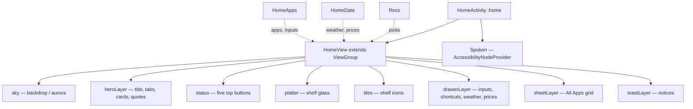

# Your TV Friend: Systems & Software Architecture

This document describes the architecture of **Your TV Friend** and **Your UI** as the code is
today (v0.0.2): the process model, how the launcher draws and moves, the theme seam added in 0.0.2,
and the measured size and memory numbers. Where something is not measured, it says so instead of
quoting a target as a result.

---

## 1. High-Level System Architecture

```
┌────────────────────────────────────────────────────────────────────────┐
│                        CLIMIN TV FRIEND TOPOLOGY                       │
└────────────────────────────────────────────────────────────────────────┘
                                     │
           ┌─────────────────────────┴─────────────────────────┐
           ▼                                                   ▼
┌───────────────────────────────────────┐   ┌───────────────────────────────────────┐
│           DEBLOAT SUBSYSTEM           │   │               CLIMIN UI               │
│               (tools/)                │   │              (launcher/)              │
├───────────────────────────────────────┼───┼───────────────────────────────────────┤
│ • Pure-Python ADB client (tv.py)      │   │ • Package: io.yourtv.home           │
│ • Recovery ledger (recovery.py)       │   │ • Plain Java, no Kotlin, no WebView   │
│ • Drift check after TV updates        │   │ • One ViewGroup drawn on a Canvas     │
│   (check.py, --fix)                   │   │ • Five looks behind one Surfaces seam │
│ • Privacy / ACR / telemetry audit     │   │ • TV Input Framework (HDMI/AV/USB)    │
│   (privacy.py)                        │   │ • TMDB picks from installed apps      │
│ • Chunked APK push (b64push.py)       │   │ • Open-Meteo weather, Binance prices  │
│ • Closed-port check (adb-closed.py)   │   │ • Photo screensaver + sleep timer     │
│ • 297 device profiles (examples/)     │   │ • 26 language catalogues              │
└───────────────────────────────────────┴───┴───────────────────────────────────────┘
```

The two halves are independent: the tools talk to the TV from a computer over `adb` or their own
ADB client, and the launcher is an ordinary APK. The only place they meet is the launcher's own
`HomeMode`, which drives the TV through **its own** ADB connection (`127.0.0.1:5555`).

---

## 2. Process Model

The manifest splits the app across four processes so a crash in the drawing code cannot take the
safety net with it:

| Process | What runs there | Why it is separate |
|---|---|---|
| *(main)* | `App`, `ModeJob` (JobService), `HomeReceiver`, `PhotoInbox` (ContentProvider), `ScreensaverAlone` | The watchdog, the mode switch and the recovery path must outlive `:home` |
| `:home` | `MainActivity` / `HomeActivity`, `SettingsActivity`, `Screensaver` | Home screen, settings and screensaver can die without losing the mode state |
| `:keys` | `RemoteKeyService` (AccessibilityService) | Branded remote buttons keep working from other apps |
| `:sleep` | `SleepOverlay` (Service) | The "Off in 12 min" pill draws over whatever app is in front |

State that has to cross a process boundary is a file or a `SharedPreferences` entry read through
`Prefs` / `HomeMode`, never a static field. `Prefs.version` is bumped on every settings write, and
each process re-reads what it needs when the version changes — that is how a look chosen in
Settings reaches the home screen without an Intent.

### 2.1 Your UI mode (`HomeMode`)

`HomeMode` is the only code that changes the TV: it connects to the TV's own ADB (`Adb.java`,
`127.0.0.1:5555`), disables the packages in its lists with `pm disable-user`, sets this app as Home
and reverses all of it on request. It runs as `ModeJob` jobs (APPLY, REVERT, VERIFY, REMOTE,
MEMORY) so nothing blocks the UI thread, and it writes a state file the settings pane follows.

- **Original ⇄ Your UI** is therefore not a switch inside the app: the app is put into Your UI
  mode by `launcher/build-and-install.sh` (or by `HomeMode.request`, which currently has no caller
  in the UI). With another launcher owning Home, the Sleep Timer pane correctly says
  *"Needs Your UI mode."* (`Capabilities.java`).
- **Watchdog** (`Watchdog.java`): every crash of `:home` is recorded in `files/home-crashes.txt`;
  three within five minutes and `HomeMode.requestRevertHome` gives Home back to the TV's own
  launcher. The count survives process death, which is the point.

---

## 3. Component Design: Your UI

### 3.1 One ViewGroup, drawn on a Canvas

There is no XML view tree, no `RecyclerView` and no per-item `View`. The home screen is a single
custom `ViewGroup`:



`HomeView` lays its children out itself, measures in a **1920×1080 design space** and scales every
coordinate by `k = width / 1920`, so a 720p panel and a 4K panel get the same composition rather
than the same pixel values.

All eight layers are `View`s added by `HomeView` (each one a `Layer`, whose `onDraw` paints one part
of the screen). Each `Layer` is marked `LAYER_TYPE_HARDWARE` unless `Ui.LEGACY` (API < 31) is set,
and each has its own dirty flag (`heroDirty`, `tilesDirty`, `statusDirty`, `drawerDirty`,
`gridDirty`, `motionDirty`), so a focus move on the shelf does not re-blur the backdrop.

Data arrives from three helpers, each of which notifies the view when it has something new:

- **`Recs`** — the three For You picks (TMDB, restricted to the streaming apps actually installed),
  cached in `SharedPreferences` together with their images, so the row renders after a restart
  without a network.
- **`HomeData`** — Open-Meteo weather (current, hourly, daily, geocoding) and Binance prices.
- **`HomeApps`** — installed apps, TV inputs (`TvInputManager` / `TvContract`), and the shortcuts
  (All Apps, Home Settings, TV Settings, Your UI settings).

### 3.2 Input and focus

Focus is a **property of the view, not of the framework**: `HomeView` handles `KeyEvent` itself and
keeps an index per region (`statusIndex`, the card index, the shelf index, the drawer row, the grid
cell). There is no `android:nextFocusDown`, no `requestFocus` chain and therefore no
`restoreDefaultFocus()` problem — the class of bug that usually forces a custom `ScrollView` on
Android TV simply does not exist here.

- **D-pad left/right/up/down** move within and between regions; up and down cross region boundaries
  in the order *tabs/cards → shelf → drawer → back*.
- **OK** opens the focused item; **hold OK** on the shelf enters reorder mode (`shiftReorder`), and
  on a tile in All Apps it pins or unpins it.
- **Back** closes All Apps, then the drawer, then returns Home.
- Branded remote keys are mapped per brand by `RemoteKeys` through `RemoteKeyService`; the OEM
  "All Apps" codes (Xiaomi's 284 and friends) open `EXTRA_ALL_APPS`.
- `Spoken` (`AccessibilityNodeProvider`) exposes a virtual node per focused item so TalkBack can
  read the screen that is drawn by hand.
- Focus is **continuous, not a highlight**: each region keeps a `Spring` per item (`tileFocus`,
  `cardFocus`, …) and the focused one grows while its neighbours settle back, so movement between
  two items is one motion rather than two states. The click sound is synthesized at runtime by
  `Click` (a short `SoundPool` "tock" written once as a WAV in the cache), not shipped as audio.

### 3.3 Motion: one spring

All motion is a **damped spring with two parameters** — response (seconds) and damping (1 = no
overshoot) — in `Spring.java`:

```java
float omega = 2π / response;
float stiffness = omega * omega, friction = 2 * damping * omega;
```

`step(dt)` integrates with a fixed 4 ms sub-step (semi-implicit Euler), so a long frame cannot make
the spring explode, and it reports `settled()` at 0.0008 / 0.004 so a resting screen stops asking
for frames. `HomeView` drives it from `Choreographer.FrameCallback`: while anything moves it posts a
frame; when everything has settled it backs off to one callback per second (`postFrameCallbackDelayed`)
instead of burning a 60 Hz loop on idle.

Day ⇄ night is blended, not switched: `HomeView` keeps a night amount in `[0,1]` and ramps it over
`NIGHT_MS = 2000`, and every colour is a `Palette.Pair` evaluated at that amount (see §4).

Press feedback is the same spring used as geometry: the focused tile grows and the row under it
brightens with the spring's value, and a short synthesized click plays on focus and on open.

### 3.4 Theme engine (new in 0.0.2)

The look is data, not a code path:

```
Prefs.look()  ──►  Look.current()  ──►  { Palette (31 day/night pairs)
   (cached on Prefs.version)            { surface recipe: GLASS | ACRYLIC | TONAL | NEON | FLAT
                                        { shape(radius) — the look's corner radius
```

- **`Look`** holds the five looks (`GLASS`, `MATERIAL`, `WINUI`, `CYBERPUNK`, `RETRO`), their
  surface recipe and their palette. `Look.current()` is cached until `Prefs.version` changes, so the
  per-frame call sites cost a field read.
- **`Surfaces`** is the single seam: every screen asks for *a panel* (`Surfaces.panel`), *a focus
  ring* (`Surfaces.focus`), *a hairline*, and gets whatever the current look draws. Glass UI replays
  the original liquid glass call into `Scene`; the other four draw their own recipe.
- **`Palette`** is 31 slots (`surface`, `ink`, `dim`, `focusBack`, `focusInk`, `pill`, `rim`,
  `accent`, …), each a day/night `Pair`. A look never decides day or night — the Mode does, and the
  night amount blends the two columns.
- **What a look may not change**: motion, geometry, icons, navigation. That is enforced by
  construction — `Look` supplies colours, a surface recipe and a radius, and nothing else. Type is
  not part of a look: all five draw the same Inter variable font. `RULES.md` §4 freezes the rest.
- **Screensaver, sleep pill and toast** read the look's **night** column, because they are always
  drawn on a dark photo or over another app. Glass UI's screensaver therefore stays pixel-identical
  (`scrimRgb` forces black for `SURFACE_GLASS`, ink stays white).

---

## 4. Rendering Pipeline

### 4.1 Glass and the backdrop (`Scene`, `Frost`, `Shaders`, `Backdrop`)

- The background is a **¼-scale layer** scaled up with bilinear filtering: the soft shapes stay
  soft, and the GPU reuses the layer between animation steps instead of redrawing per frame.
- On Android 13+ the aurora and the liquid glass are **AGSL runtime shaders**; the glass samples the
  frosted copy of what is behind it.
- Without AGSL (Android 8–12) the glass is still glass: the background's blurred copy — the same
  `int[]` the shaders would read, box-averaged into a small bitmap — is drawn through the rounded
  shape, mapped so it shows what is really behind it, then the tint, the rim and the top sheen.
  All of those bitmaps are made once and reused; nothing is allocated per frame.
- If AGSL fails at runtime the code falls back to a gradient and plain translucent glass, so the
  screen is never blank.

### 4.2 Images

```
Backdrop:  source ──► blurred, reduced-size ARGB_8888 bitmap (one per day/night)
                    └► Bitmap.Config.HARDWARE when the GPU can take it
Recs:      TMDB image ──► disk cache (JPEG) ──► SharedPreferences index
Photos:    user photo ──► BitmapRegionDecoder + EXIF rotation ──► cached copy, JPEG q=86
Icons:     PackageManager ──► getDrawableForDensity(id, DENSITY_XXXHIGH)  (640 dpi)
```

Icons are requested at **XXXHIGH (640 dpi)** whatever the panel is, because a TV is often 1080p or
4K and the app's own icon density is unrelated to the screen; the result is drawn at the tile size
with filtering on, so it is downscaled rather than upscaled.

---

## 5. Localization

26 catalogues live in `launcher/app/src/main/assets/i18n/<lang>.json`, keyed by the English string in
the code:

```java
Ui.tr("Live TV")                       // static text
Ui.trf("{n} min ago", "n", 12)         // named placeholders
Ui.tr("night|Clear")                   // "context|Text": a different word for the same English
```

The active catalogue is one `HashMap` swapped whole when the language changes, so a lookup is a
`get()` that allocates nothing; `PluralRules` and a per-language region table handle plurals and
date/number formatting. A language without a catalogue entry falls back to the plain English key,
then to the English itself — a missing translation can never blank a label.

---

## 6. Dependencies

The launcher is written in **plain Java 17** against the Android framework:

- No Kotlin, no Compose, no WebView, no Glide/OkHttp/Retrofit. Networking is `HttpURLConnection`,
  JSON is `org.json`, images are `BitmapFactory`/`BitmapRegionDecoder`.
- `androidx.recyclerview`, `androidx.dynamicanimation` and `androidx.cardview` are declared in
  `launcher/app/build.gradle` but **no source file imports any AndroidX class**; release builds have
  R8 (`minifyEnabled`, `shrinkResources`) so they do not reach the APK. They are candidates for
  removal from the build file.

---

## 7. Resource & Memory Budget

Measured on the reference TV — a TCL Android 9 (API 28) panel at 1280×720 — with the 0.0.2 release
build installed as a normal app:

| Metric | Measured | Notes |
|---|---|---|
| **Release APK** | **1,405,520 bytes (1.4 MB)** | R8 + resource shrinking, debug keystore |
| **PSS, `:home`** | **≈ 41 MB** (`TOTAL 42225 KB`) | home screen + settings + screensaver process |
| **PSS, whole app** | not measured | `:keys` and `:sleep` were not sampled together with `:home` |
| **Cold start** | not measured | no frame-timing run in this cycle |
| **Dependencies** | framework only | the three AndroidX entries are unused (§6) |
| **Min / target SDK** | 26 (Android 8.0) / 34 (Android 14) | compiled with SDK 34, Java 17 |
| **Languages** | 26 | `assets/i18n` |
| **Device profiles** | 297 | `examples/` |

The earlier "< 35 MB RSS" and "248 KB APK" figures in this document were targets, never results; they
have been replaced with the measurements above.

---

## 8. Failure Behaviour

| Failure | What happens |
|---|---|
| `:home` crashes | `Watchdog` counts it; on the 3rd within 5 min Home goes back to the TV's launcher |
| Settings changed while `:home` is dead | `Prefs.version` differs, so the activity starts over with the new values |
| AGSL unavailable or failing | gradient + translucent glass fallback, never a blank screen |
| Picks offline or no TMDB key | cached picks if any, else the clock/weather/price view |
| No pick photos | the user's own photos, else a light gradient |
| TV refuses "draw over other apps" | the sleep pill falls back to the minute count on the home screen |
| TV's ADB is off | `Capabilities` reports *"Needs Your UI mode."*; nothing is attempted |
| Debugging switched off after setup | `tools/adb-closed.py` verifies port 5555 is closed again |

---

## 9. Related Documents

- [`UI_MAP.md`](../UI_MAP.md) — every screen, section by section, with coordinates and look tokens.
- [`RULES.md`](../RULES.md) — what is frozen and how a change is proposed.
- [`docs/testing.md`](testing.md) — remote navigation matrix and ADB runbooks.
- [`docs/changelog.md`](changelog.md) — release history, including the 0.0.2 theme work.
