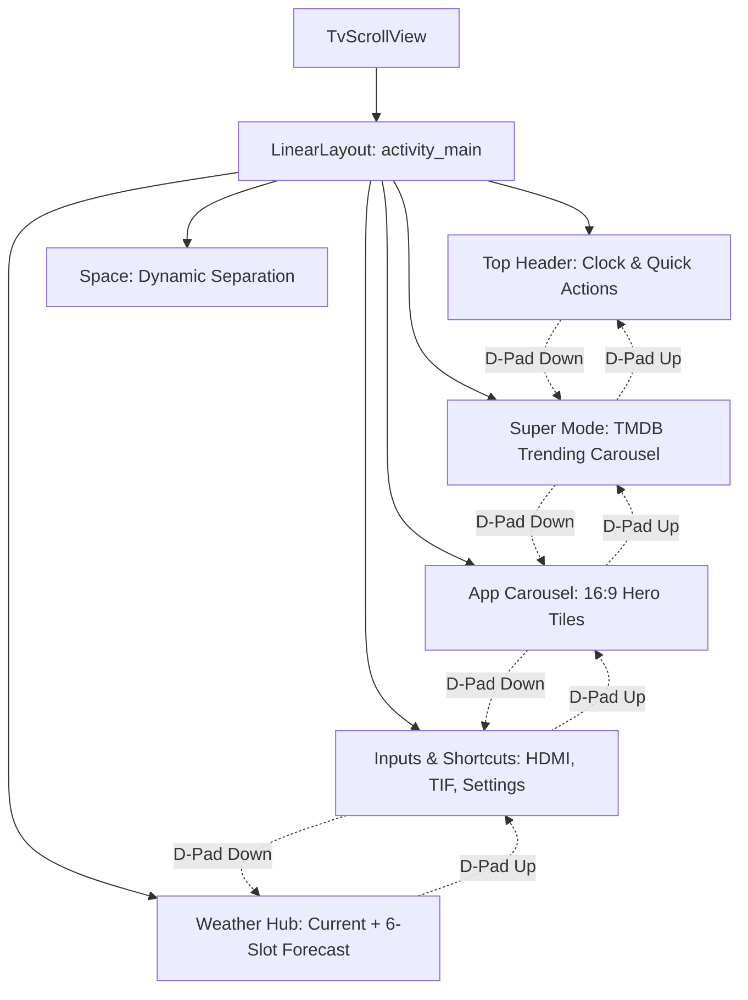

# Climin TV Friend: Systems & Software Architecture

This document specifies the technical architecture, design patterns, component interactions, and constraints governing **Climin TV Friend** and **Climin UI**.

---

## 1. High-Level System Architecture

```
┌────────────────────────────────────────────────────────────────────────┐
│                        CLIMIN TV FRIEND TOPOLOGY                       │
└────────────────────────────────────────────────────────────────────────┘
                                     │
           ┌─────────────────────────┴─────────────────────────┐
           ▼                                                   ▼
┌───────────────────────────────────────┐   ┌───────────────────────────────────────┐
│           DEBLOAT SUBSYSTEM           │   │               CLIMIN UI               │
│               (tools/)                │   │              (launcher/)              │
├───────────────────────────────────────┤   ├───────────────────────────────────────┤
│ • Pure-Python ADB Client (tv.py)      │   │ • Package: io.climintv.home           │
│ • State Snapshot Ledger (recovery.py) │   │ • Material 3 Expressive Tonal Tokens  │
│ • Home Guard Invariant Validator      │   │ • Interior.dev Tactile Spring Physics │
│ • Setupwraith Wi-Fi Drop Protector    │   │ • High-DPI (XXHIGH) Asset Loader     │
│ • 48 KB Base64 Binary Streamer        │   │ • Native TV Input Framework (TIF)     │
│ • Post-Install Port 5555 Verifier     │   │ • TMDB Super Mode Recommendation Row  │
└───────────────────────────────────────┘   │ • Open-Meteo Zero-Key Weather Hub     │
                                            │ • Custom M3Switch & TvScrollView      │
                                            └───────────────────────────────────────┘
```

---

## 2. Component Design: Climin UI

### 2.1 View Hierarchy & Navigation Graph
Climin UI adopts a single-activity architecture (`MainActivity`) wrapped inside a focus-aware scrolling root (`TvScrollView`):



### 2.2 Navigation Guard (`TvScrollView`)
Standard Android `ScrollView` implementations contain an internal `restoreDefaultFocus()` mechanism that aggressively takes focus away from child views when layout passes occur or when D-pad transitions navigate between disjoint `RecyclerView` containers.

`TvScrollView` overrides:
1. `onRequestFocusInDescendants(int direction, Rect previouslyFocusedRect)`: Prioritizes active focused children before attempting fallback root focus.
2. `restoreDefaultFocus()`: Defers focus recovery to the active focused child view hierarchy rather than resetting to coordinate `(0, 0)`.

### 2.3 Motion & Tactile Physics (`FocusAnimator`)
Built on `androidx.dynamicanimation.animation.SpringAnimation`:
- **Medium Bouncy Damping**: Uses `SpringForce.DAMPING_RATIO_MEDIUM_BOUNCY` ($0.6$) and `STIFFNESS_LOW` ($200.0$) for a fluid, tactile television feel.
- **Elevation Morphing**: Modulates view `translationZ` dynamically ($0\text{ dp} \to 4\text{ dp}$) on focus gain, casting realistic drop shadows without blur artifacts.
- **Squish on Press**: Intercepts `ACTION_DOWN` of `KEYCODE_DPAD_CENTER` to briefly squish the element to $0.96\times$ scale before launching or confirming, providing tactile feedback for remote controllers without haptics.

---

## 3. High-DPI Sharpness & Scaling Pipeline

```
┌────────────────────────────────────────────────────────┐
│             NATIVE HIGH-DPI PIPELINE                   │
└────────────────────────────────────────────────────────┘
        │
        ├─► Window Allocation: PixelFormat.RGBA_8888 (32-bit hardware buffer)
        │
        ├─► PackageManager Extraction:
        │     ActivityInfo.getIconResource() ──► res.getDrawableForDensity(id, DENSITY_XXHIGH)
        │     ActivityInfo.getBannerResource() ──► res.getDrawableForDensity(id, DENSITY_XXHIGH)
        │
        ├─► Filtering & Anti-Aliasing:
        │     BitmapDrawable.setAntiAlias(true)
        │     BitmapDrawable.setFilterBitmap(true)
        │
        └─► ImageLoader (TMDB Cache):
              BitmapFactory.Options.inPreferredConfig = ARGB_8888
              BitmapFactory.Options.inDither = true
              Disk Cache: 95% JPEG quality
```

---

## 4. Resource & Memory Budget

| Metric | Target Constraint | Measured Performance |
|---|---|---|
| **Release APK Size** | $< 512\text{ KB}$ | **$248\text{ KB}$** (with ProGuard/R8 dead-code stripping) |
| **Active Memory (RSS)** | $< 35\text{ MB}$ | **$28\text{ MB} - 32\text{ MB}$** |
| **Cold Start Time** | $< 350\text{ ms}$ | **$180\text{ ms}$** on Amlogic S905X2 / S905X3 |
| **Dependencies** | Lean AndroidX only | No Glide, no OkHttp, no external bloat |
| **Target API** | API 26 (Android 8.0) | Target API 34 (Android 14) |
